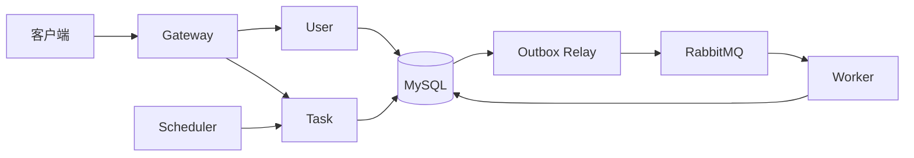

# TaskFlow

TaskFlow 是一个 Java 17 定时任务调度系统。它支持 ONCE 和 Cron 任务、基于 MySQL Outbox 的消息发布、RabbitMQ 消费以及 Worker 租约恢复。用户经 Gateway 注册和登录，Task 按调用者身份限制任务访问。



Relay 和 Worker 当前都运行在 Task 服务内。Scheduler 通过内部接口触发派发。

## 本地启动

需要 JDK 17、能运行 Linux 容器的 Docker 引擎和 Docker Compose。在仓库根目录的 PowerShell 中运行：

```powershell
java -version
docker version
docker compose version
.\mvnw.cmd -B verify
```

构建输出应显示 `BUILD SUCCESS`。Compose 会挂载四个服务模块在 `target` 下打包出的 JAR。

给新的实验环境生成凭据。请把凭据文件留在仓库外。同一套 MySQL 或 RabbitMQ 数据卷再次启动时，继续使用原凭据文件。

```powershell
$envFile = Join-Path $env:LOCALAPPDATA 'TaskFlow\day50.env'
New-Item -ItemType Directory -Force (Split-Path $envFile) | Out-Null
if (-not (Test-Path -LiteralPath $envFile)) {
    $names = @(
        'DAY45_MYSQL_PASSWORD'
        'DAY45_MYSQL_ROOT_PASSWORD'
        'DAY45_RABBIT_PASSWORD'
        'TASKFLOW_JWT_SECRET_BASE64'
        'TASKFLOW_GATEWAY_TOKEN'
        'TASKFLOW_SCHEDULER_TOKEN'
    )
    $rng = [System.Security.Cryptography.RandomNumberGenerator]::Create()
    try {
        $lines = foreach ($name in $names) {
            $bytes = New-Object byte[] 32
            $rng.GetBytes($bytes)
            "$name=$([Convert]::ToBase64String($bytes))"
        }
        Set-Content -LiteralPath $envFile -Value $lines -Encoding ascii
    } finally {
        $rng.Dispose()
    }
}

$compose = @('--env-file', $envFile, '-p', 'taskflow-demo', '-f', 'compose.day45.yml')
docker compose @compose config --quiet
docker compose @compose up -d --wait
docker compose @compose ps
```

首次使用空卷时，MySQL 会初始化任务库和用户库。确保宿主机的 `8090` 未被其他程序占用。该配置只向宿主机发布 Gateway 的 `127.0.0.1:8090`。如果应用刚启动还在初始化，等 Gateway 和 User 就绪后再发请求。

## 演示一条 ONCE 任务

继续在同一个 PowerShell 中运行：

```powershell
$base = 'http://127.0.0.1:8090'
$suffix = [guid]::NewGuid().ToString('N').Substring(0, 8)
$a = @{ username = "demo_a_$suffix"; password = [guid]::NewGuid().ToString('N') }
$b = @{ username = "demo_b_$suffix"; password = [guid]::NewGuid().ToString('N') }
function Post-Json($path, $body, $headers = @{}) {
    Invoke-RestMethod -Method Post -Uri "$base$path" -Headers $headers `
        -ContentType 'application/json' -Body ($body | ConvertTo-Json -Depth 5)
}

Post-Json '/api/users/register' $a | Out-Null
Post-Json '/api/users/register' $b | Out-Null
$tokenA = (Post-Json '/api/users/login' $a).data.accessToken
$tokenB = (Post-Json '/api/users/login' $b).data.accessToken
$headersA = @{ Authorization = "Bearer $tokenA" }
$headersB = @{ Authorization = "Bearer $tokenB" }

$task = Post-Json '/api/tasks' @{
    name = "demo_$suffix"
    handlerType = 'PRINT_LOG'
    triggerType = 'ONCE'
    timezone = 'UTC'
    nextTriggerAt = [DateTime]::UtcNow.AddSeconds(10).ToString('yyyy-MM-ddTHH:mm:ss')
    payload = @{ message = 'hello TaskFlow' }
    idempotencyKey = [guid]::NewGuid().ToString()
} $headersA

$id = [long]$task.data.taskId
Invoke-RestMethod -Uri "$base/api/tasks/$id" -Headers $headersA
try {
    Invoke-RestMethod -Uri "$base/api/tasks/$id" -Headers $headersB -ErrorAction Stop
    throw 'B unexpectedly read the task'
} catch {
    if ([int]$_.Exception.Response.StatusCode -ne 404) { throw }
    'B received HTTP 404'
}
```

创建接口成功表示任务定义已保存。等计划到期，由 Scheduler 派发、Worker 执行后，用下面的命令查看对应实例和尝试。如果还没有记录，等下一轮派发再查。

```powershell
$sql = @"
SELECT i.id AS instance_id, i.status AS instance_status,
       e.attempt_no, e.status AS execution_status
FROM task_instance i
JOIN task_execution e ON e.instance_id = i.id
WHERE i.definition_id = $id
ORDER BY i.id, e.attempt_no
"@

$sql | docker compose @compose exec -T mysql sh -c 'MYSQL_PWD="$MYSQL_PASSWORD" exec mysql -u "$MYSQL_USER" "$MYSQL_DATABASE"'
```

实例和对应的执行尝试都应显示 `SUCCESS`。演示结束后可用 `docker compose @compose stop` 停止容器，保留数据卷。

## 验收记录与范围

- Windows 本机用已有 Maven 缓存完成全模块 `verify`，67 条测试通过。测试报告位于各模块的 `target/surefire-reports`。
- 新 Compose 项目用空 MySQL 和 RabbitMQ 卷验证了注册、登录、匿名请求拒绝、跨用户读取拒绝及 ONCE 到期执行。
- 调度扫描对照实验使用 10 万条定义、1,000 条到期、单连接、`LIMIT 50`。索引可用与不可用时，四轮 P95 的中位数分别为 1.50 ms 和 78.35 ms。这是扫描 SQL 的测量。
- 新电脑首次下载依赖、真实短信等外部副作用和完整派发链路吞吐尚未在最终验收中测量。
